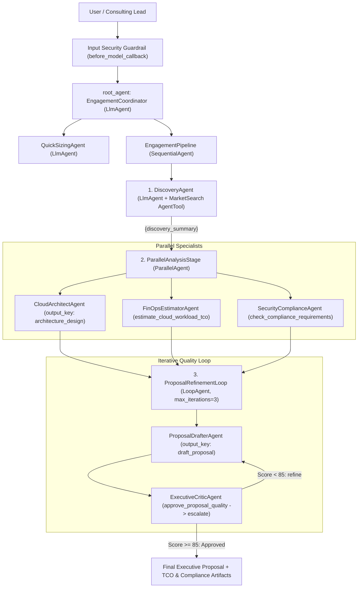

# Enterprise Cloud Transformation & Architecture Co-Pilot

An enterprise-grade **Multi-Agent System** built on the **Google Agent Development Kit (ADK-Python)** and **Google Cloud Vertex AI** (`gemini-2.5-flash`).

## 1. Problem & Solution Statement

* **Track**: Enterprise Agents
* **Problem**: Preparing enterprise cloud transformation proposals requires synthesizing live market context, designing target cloud architectures, modeling Total Cost of Ownership (TCO) / Committed Use Discounts (CUDs), auditing regulatory compliance (FSI, Healthcare, Retail), and iteratively reviewing executive quality—a manual workflow that typically takes days across multiple silos.
* **Solution**: **Enterprise Cloud Transformation Co-Pilot** automates this end-to-end workflow using a coordinated multi-agent pipeline (`LlmAgent`, `SequentialAgent`, `ParallelAgent`, and `LoopAgent`) equipped with domain-specific `FunctionTool`s, `google_search` grounding, stateful session memory (`ToolContext`), prompt-injection security guardrails, OpenTelemetry distributed tracing, structured JSON logging, automated evaluations, and production Cloud Run / Vertex AI Agent Engine CI/CD.

---

## 2. System Architecture



---

## 3. Core Course Capabilities Implemented

| Assessment Pillar | Implementation Details |
| :--- | :--- |
| **1. Tool & Interface Design** | Typed `FunctionTool`s (`estimate_cloud_workload_tco`, `check_compliance_requirements`, `save_engagement_artifact`, `approve_proposal_quality`), isolated `google_search` `AgentTool`, and Pydantic v2 input/output schemas (`consulting_agent/schemas.py`, `consulting_agent/tools.py`). |
| **2. Context & Memory** | `InMemorySessionService` & `InMemoryMemoryService` (`consulting_agent/memory.py`), scoped `tool_context.state` persistence (`user:`, `app:`, session keys), cross-agent `{state_key?}` template injection, and context-window history compaction. |
| **3. Orchestration & Logic** | Hierarchical `LlmAgent` Coordinator delegating to a `SequentialAgent` -> `ParallelAgent` (3 concurrent domain specialists) -> `LoopAgent` (drafter/critic loop with `escalate=True` exit condition), plus `before_model_callback` prompt-injection & PII guardrails and exponential backoff retries (`consulting_agent/agent.py`, `consulting_agent/guardrails.py`). |
| **4. Observability & Tracing** | OpenTelemetry `TracerProvider` (with optional `CloudTraceSpanExporter`), structured JSON logging (`trace_id`, `span_id`, `latency_ms`, `token_count`), ADK lifecycle callbacks (`before/after_agent`, `before/after_model`, `before/after_tool`), unit tests (`tests/`), and ADK evaluation dataset (`evaluations/`). |
| **5. Infrastructure & CI/CD** | Production multi-stage `Dockerfile`, FastAPI server (`app.py`), GitHub Actions CI/CD (`.github/workflows/ci-cd.yml` with lint, pytest, and Cloud Run deploy via Workload Identity Federation), `cloudbuild.yaml`, Vertex AI Agent Engine deployment (`deploy_agent_engine.py`), and Terraform IaC (`infra/main.tf`). |

---

## 4. Repository Structure

```text
.
├── consulting_agent/
│   ├── __init__.py          # Exports root_agent for ADK CLI / Agent Engine
│   ├── agent.py             # Multi-agent orchestration (Coordinator, Sequential, Parallel, Loop)
│   ├── guardrails.py        # Prompt-injection, PII scrubbing & tool validation callbacks
│   ├── memory.py            # Session & long-term memory runner + context compaction
│   ├── observability.py     # OpenTelemetry tracing, structured JSON logs & telemetry callbacks
│   ├── schemas.py           # Pydantic v2 domain models & structured contracts
│   └── tools.py             # Custom FunctionTools with ToolContext state persistence
├── evaluations/
│   └── consulting_eval.test.json  # ADK evaluation test cases & tool trajectory assertions
├── infra/
│   └── main.tf              # Terraform IaC for Cloud Run, IAM & Secret Manager
├── tests/
│   └── test_agent_system.py # Unit tests for tools, guardrails, memory & agent topology
├── .github/workflows/
│   └── ci-cd.yml            # GitHub Actions CI (Ruff + Pytest) & CD (Cloud Run)
├── app.py                   # FastAPI production HTTP server (/chat, /healthz, /metrics)
├── cloudbuild.yaml          # Google Cloud Build CI/CD pipeline
├── deploy_agent_engine.py   # Vertex AI Agent Engine deployment script
├── Dockerfile               # Hardened non-root Python 3.12 container image
├── pyproject.toml           # Project metadata, Ruff & Pytest configuration
└── requirements.txt         # Pinned runtime & test dependencies
```

---

## 5. Quick Start

### Prerequisites
* Python 3.11+
* A Google Cloud Project with Vertex AI enabled **or** a Gemini API Key

### Local Installation & Execution

```bash
python3 -m venv .venv
source .venv/bin/activate
pip install -r requirements.txt

# Option A: Vertex AI
export GOOGLE_GENAI_USE_VERTEXAI="TRUE"
export GOOGLE_CLOUD_PROJECT="your-gcp-project-id"
export GOOGLE_CLOUD_LOCATION="global"

# Option B: Gemini Developer API
# export GOOGLE_GENAI_USE_VERTEXAI="FALSE"
# export GOOGLE_API_KEY="your-api-key"

# Launch interactive ADK Web UI
adk web

# Or start the production FastAPI service
uvicorn app:app --host 0.0.0.0 --port 8080
```

### Run Unit Tests & Linting

```bash
pytest -v
```

### Deploy to Google Cloud Run / Vertex AI Agent Engine

```bash
# Cloud Build -> Cloud Run
gcloud builds submit --config cloudbuild.yaml

# Or deploy directly to Vertex AI Agent Engine
python3 deploy_agent_engine.py --project "$GOOGLE_CLOUD_PROJECT" --location us-central1
```
